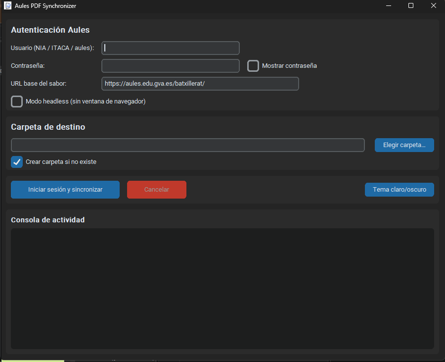

# Aules PDF Synchronizer 1.1.50



Aplicación de escritorio para descargar y organizar automáticamente los materiales de tus asignaturas en Aules (Moodle de la Generalitat Valenciana).

## Características

- Interfaz moderna con CustomTkinter (tema claro/oscuro).
- Autenticación compatible con el flujo de Aules / GVA (modo visible para MFA o verificaciones adicionales).
- Organización automática por asignatura y sección/tema.
- Descarga y organización de archivos PDF, Word, PowerPoint, Excel, OpenDocument, RTF, TXT y CSV.
- Mantiene el nombre y la extensión original del archivo descargado.
- Omite las asignaturas cuyo nombre contiene «Orientación».
- Evita duplicados (no redescarga archivos existentes).
- Descargas autenticadas, validación de archivos y reintentos.
- Registro detallado en tiempo real y resumen final.
- Selectores y URL base configurables para adaptarse a cambios de Moodle.

## Requisitos

- Python 3.11 o superior
- Google Chrome o Chromium
- Conexión a Internet

## Instalación

```bash
python -m venv venv
# Windows (PowerShell)
venv\Scripts\activate

pip install -r requirements.txt
python main.py
```

## Ejecutable para Windows

El ejecutable ya compilado se encuentra en `release/Aules_PDF_Synchronizer.exe`.
No requiere Python instalado. Google Chrome debe estar instalado y se necesita
conexión a Internet para descargar el controlador compatible y acceder a Aules.
El `.exe` de esta versión también está disponible en [GitHub Releases](https://github.com/Bode512/Aules_PDF_Synchronizer/releases/tag/v1.1.50).

Para compilarlo de nuevo en Windows:

```powershell
python -m venv venv
.\venv\Scripts\Activate.ps1
python -m pip install -r requirements.txt
python -m pip install -r requirements-build.txt
python -m PyInstaller --clean --noconfirm --onefile --windowed `
  --name Aules_PDF_Synchronizer --icon image.ico `
  --add-data "image.ico;." --distpath release --workpath build `
  main.py
```

La compilación genera `release/Aules_PDF_Synchronizer.exe`, con el icono de
`image.png` convertido a `image.ico`. La aplicación requiere Chrome; para
completar MFA o CAPTCHA, utiliza el modo navegador visible.

## Preparar un release

Después de actualizar `APP_VERSION` en `config.py`, ejecuta:

```powershell
.\preparar_release.ps1
```

El script comprueba si hay cambios desde el último tag, ejecuta las pruebas y
compila el `.exe` únicamente si los hay. No crea commits, tags ni publica en
GitHub. Durante las descargas muestra la cuenta atrás y el motivo de cada
reintento; los errores de permisos se notifican inmediatamente.

**Cómo funciona la autenticación y la sincronización**

1. Se abre Chrome (visible o headless) y se navega a `{BASE_URL}/login/index.php`.
2. Se rellenan `#username` y `#password` y se pulsa `#loginbtn`.
3. Se espera a la aparición del menú de usuario o del dashboard. Si aparece una redirección a servicios de identidad GVA, en modo visible el usuario puede completarla manualmente.
4. Se copian las cookies de Selenium a una sesión `requests`.
5. Se visita el área personal (`/my/`), se extraen los enlaces a `course/view.php`.
6. Por cada curso se recorren las secciones y se buscan recursos de archivo de Moodle.
7. Se descargan los formatos compatibles a un temporal, se valida su tipo y se guardan en `Asignatura/Sección/archivo.ext`; los enlaces intermedios de Moodle se resuelven mediante la sesión HTTP autenticada.
8. Todo el progreso se envía a la GUI mediante una cola thread-safe.

**Limitaciones conocidas y posibles ajustes**

- La estructura exacta de las tarjetas de curso y de las secciones puede variar entre sabores y versiones de Moodle (4.5 → 5.2). Por eso todos los selectores están en `config.py`. Si tras una actualización dejan de detectarse cursos o archivos, inspecciona la página y actualiza únicamente esos selectores.
- No se implementa comparación avanzada de contenido (hash/ETag) para decidir si un archivo remoto ha cambiado, para no generar carga innecesaria sobre los servidores de Aules. Si el archivo local existe y tiene tamaño > 0 se omite.
- Las esperas indicadas en la consola son pausas breves antes de reintentar tras un error temporal. Los errores de acceso denegado se notifican inmediatamente y no se reintentan.
- El programa no ha sido ejecutado de extremo a extremo con credenciales reales en este entorno (no dispongo de una cuenta de Aules). La lógica de login se ha verificado contra la página de login real de un sabor público y los selectores estándar de Moodle 4.x.
- Respeta siempre los términos de uso de la plataforma y utiliza la herramienta únicamente con tu propia cuenta y para material al que tengas derecho de acceso.

Con estos archivos tienes una aplicación de escritorio completa, modular y preparada para adaptarse a los cambios habituales de Aules. Si tras probarla encuentras que algún selector concreto ha cambiado en tu sabor, indícalo y te ayudo a ajustarlo.


#ESTE app fue hecho por grok.com y gpt-6-luna -> OpenAI.com
##quien arreglaba los errores es copilot